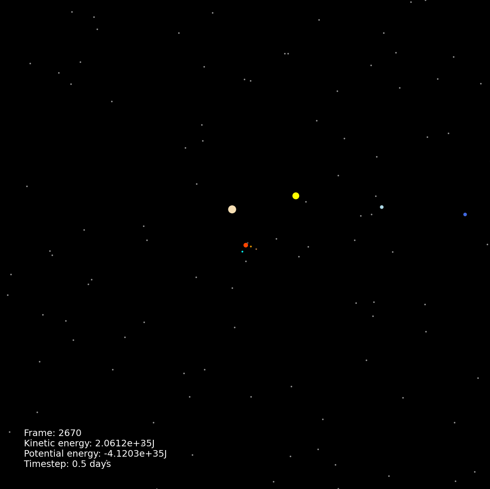

# Planet Orbit Simulator
1. `pip install orbitz`
2. `python -m orbits`
3. `run`

## Overview
This is a planetary orbits simulator designed to simulate the orbits of planets in our Solar system. The project is built in Python, using Numpy and MatplotLib for computations and rendering. The package comes prebuilt and available to use through a CLI.

## Features
- Simulate free-body problem with adaptive Celestial objects.
- Visualize planets on a 2D MatplotLib window in real time.
- Customize simulation parameters directly from custom JSON files.
- Store and analyse data from CSV files across different simulations.

## Requirements
Requires Python 3.10 or greater. Uses MatplotLib and NumPy.

##  Installation
1. `pip install orbitz`

## Usage
1. `python -m orbits` to load the CLI
2. Alternatively, `cd` into the relevant directory and run the `run.py` with `python run.py`.
3. Type `help` to get a list of commands, or `run` to run the simulation with default values.
4. Wait for the loading bar to reach 100%, then a window will appear, displaying the simulation.

## Project Structure
Orbits/\
├── results/\
│   ├── energy-data.csv\
│   └── ...\
├── src/\
│   ├── data/\
│   │   ├── solar_system.json  - Simulation parameters\
│   │   ├── test.json\
│   │   └── ...\
│   ├── orbits/\
│   │   ├── \_\_init__.py   - Module file\
│   │   ├── \_\_main__.py   - Main file that loads terminal prompt\
│   │   ├── config.py   - Paths/constants\
│   │   ├── orbit.py    - Simulation and MatplotLib window\
│   │   ├── celestials.py   - Contains Celestial class for planets\
│   │   ├── energy_comparison.py    - Handles plotting with gathered data\
│   │   └── progress_bar.py - Provides a loading bar to show progress\
│   └── tests/\
│       └── test.py        - Combined test file\
├── .gitignore\
├── conftest.py\
├── setup.py\
├── run.py\
└── README.md\
